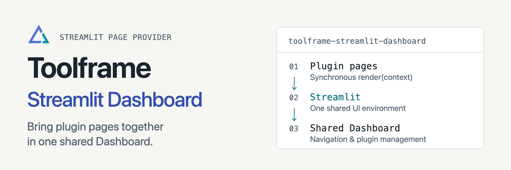

<p align="center">
<picture>
  <source media="(prefers-color-scheme: dark)" srcset="docs/assets/readme-banner-dark.png">
  <source media="(prefers-color-scheme: light)" srcset="docs/assets/readme-banner-light.png">
  
</picture>
</p>

# Toolframe Streamlit Dashboard

[](https://github.com/toolframe/toolframe-streamlit-dashboard/actions/workflows/ci.yml?query=branch%3Amain)

Publish plugin pages and manage a Toolframe application in one Streamlit dashboard.
Business plugins supply pages; Core supplies trusted access and service calls.

## Quick start

In a running [Toolframe application](https://github.com/toolframe/toolframe-core#readme):

```sh
toolframe --home APP plugin add pypi:toolframe-streamlit-dashboard==0.5.2 --enable
```

Use Python 3.14+ and SDK 0.4.1+. In another terminal, run
`toolframe --home APP open` for the local sign-in link. The Entry Register recipe
already includes this provider.

**Lifecycle:** page packages share one UI environment. Changing a page package
replaces the Dashboard process; browser sessions reconnect and session state may
reset. Business services and persisted data remain independently owned.

Pages declare permissions, and Core checks every service call. Management actions
use **Preview operation** followed by **Apply**. Dashboard Auth supplies the
optional login and access-management pages.

## Guides

| I want to… | Start here |
| --- | --- |
| Generate a Notes page | [Notes template](docs/templates.md) |
| Manage plugins and inspect dependencies | [Dashboard operations](docs/runtime.md) |
| Configure login | [Dashboard Auth](https://github.com/toolframe/toolframe-dashboard-auth) |
| Contribute or run checks | [Contributing](CONTRIBUTING.md) · [Verification](docs/ci.md) |
| Publish a package | [Releasing](docs/releasing.md) |

[Releases](https://github.com/toolframe/toolframe-streamlit-dashboard/releases)

## License

Provider: [Apache 2.0](LICENSE), with [NOTICE](NOTICE).
The bundled Notes template and generated projects use MIT.
